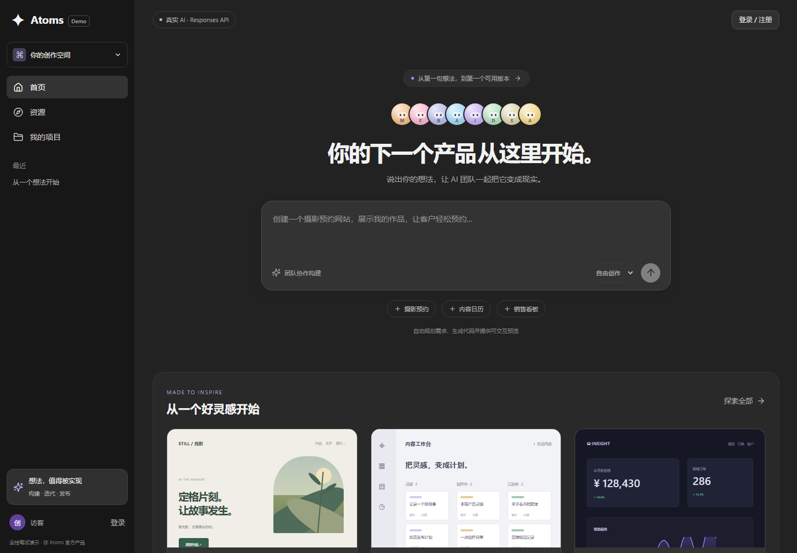
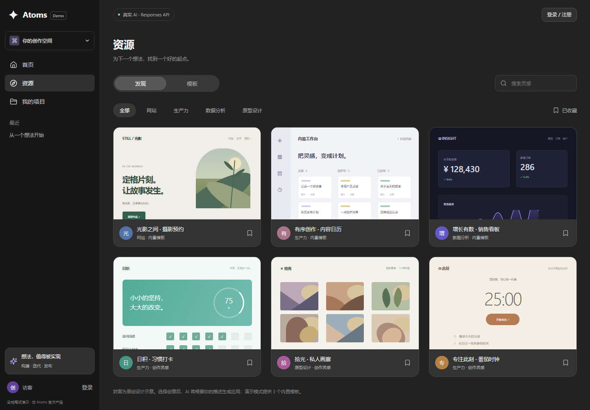
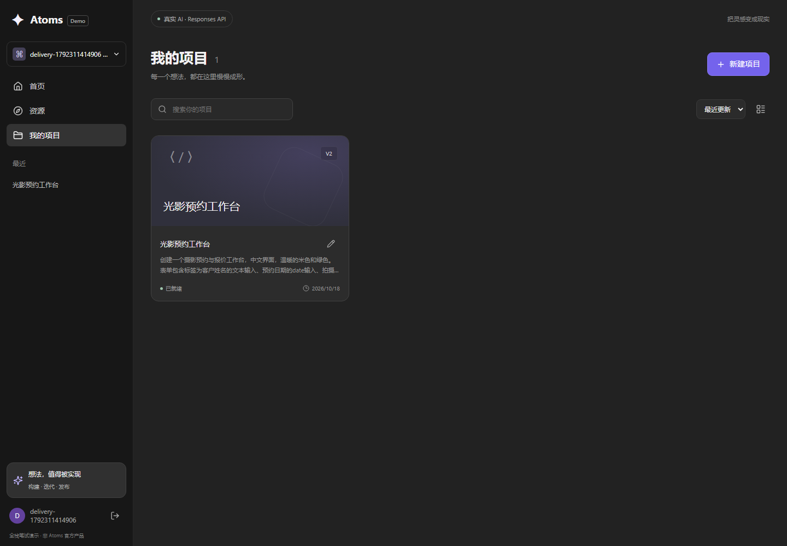

# 官网对照与改版说明

日期：2026-10-18。交付版本：2.0.0。

本轮改造针对“已有实现与 Atoms 官网差距较大”的反馈，重新核对产品结构和实际交互，在保留已有真实生成、存储和发布能力的基础上重做界面。

## 参考来源与实际观察

- 已完整阅读本地笔试 Markdown 及其图片附件；原题材料不纳入公开仓库。
- 参考 [Atoms 帮助中心](https://help.atoms.dev/zh)、[欢迎文档](https://help.atoms.dev/zh/articles/12129543-welcome-to-atoms)、[项目聊天](https://help.atoms.dev/zh/articles/12129550-project-chat) 和 [应用预览](https://help.atoms.dev/zh/articles/12129554-app-viewer)。
- 用户提供了登录后的资源页截图，显示深灰侧栏、发现/模板切换、分类与大型应用卡片。
- 用户重启 Chrome 后，实际连接其浏览器，读取并截图核对 [Atoms 首页](https://atoms.dev/zh/dashboard)，通过最近项目进入已有聊天工作区，核对聊天、团队身份、折叠步骤和编辑区域。
- 此次官网操作仅查看页面，没有在用户的 Atoms 账户中提交生成任务、发布项目、改动订阅或修改已有项目内容。用户表示已开通 Pro 70 美元会员；本轮没有据此推断实际账单或额度消耗。

用户官网截图包含个人空间信息，未复制到公开仓库。下方交付截图只展示本项目和验收用数据。

## 本轮具体变化

| 界面 / 流程 | 原实现 | 本轮交付 |
| --- | --- | --- |
| 入口 | 登录后直接进入默认项目 | 可浏览的首页、产品想法输入区、风格选择、团队头像与灵感入口；填写想法后可注册并继续构建 |
| 整体风格 | 绿色强调色、密集三栏 | 中性深灰、细边框、适度圆角、蓝紫强调色；首页侧栏与工作区窄导航分开 |
| 资源 | 没有独立资源页 | 六张原创应用概念卡片；发现/模板、分类、关键词、详情与收藏；收藏保存在浏览器 |
| 项目 | 仅侧栏切换 | 独立项目页，搜索、排序、网格/列表、重命名、状态和更新时间；按账户持久化 |
| 团队对话 | 平铺角色、摘要和 JSON | 可展开团队面板、具名头像、用户/团队消息层级、复制回复、折叠运行步骤；结构化文档按中文字段阅读 |
| 应用预览 | 三栏中的有限面积 | 桌面优先两栏，支持专注预览、刷新和 390px 模拟；手机以对话/预览切换显示 |
| 代码 | 只读文本 | 可编辑 HTML，保存为新版本；服务端验证所有权、大小、版本冲突并清理代码；不自动更新公开版本 |
| 重新打开项目 | 浏览器选择记录恢复 | 项目哈希地址支持刷新与直达；构建中刷新后轮询持久化状态，避免再次自动发起相同任务 |
| 发布 | 基本发布与撤销 | 保留固定发布版本，增加可复制链接和明确的工作版本/线上版本信息 |

## 实现边界

资源封面是本项目原创 HTML/CSS/SVG 设计示意，并明确标注“内置模板”或“创作灵感”。点击后填入可编辑的需求，应用由当前配置的生成服务实际构建；不冒充官网社区作品或虚构用户数、浏览量。

界面中的八位专家名称参考 Atoms 的角色体系；头像使用原创 CSS 图形。实际执行仍是现有 Responses 模型的多角色编排。没有展示不可用的支付、积分、连接器或语音按钮。

源码编辑保存使用与生成相同的 HTML 清理规则，受 50 KB 上限约束，并检查 `baseVersion`。版本写入和恢复共享项目锁，过期编辑返回 409，不覆盖新成果。此编辑器是单文件文本编辑，不是官网完整的可视化编辑器或多文件 IDE。

构建状态恢复只恢复观察：网络断开后可重新加载已持久化记录，并等待仍在服务器运行的任务；服务器进程被终止后的真正断点续跑仍需要持久化任务队列。

## 实际页面

[查看手机首页截图](./截图/07-home-mobile.png)。

工作区和公开应用的真实模型验收截图见 [验收与部署记录](./验收与部署记录.md)。
