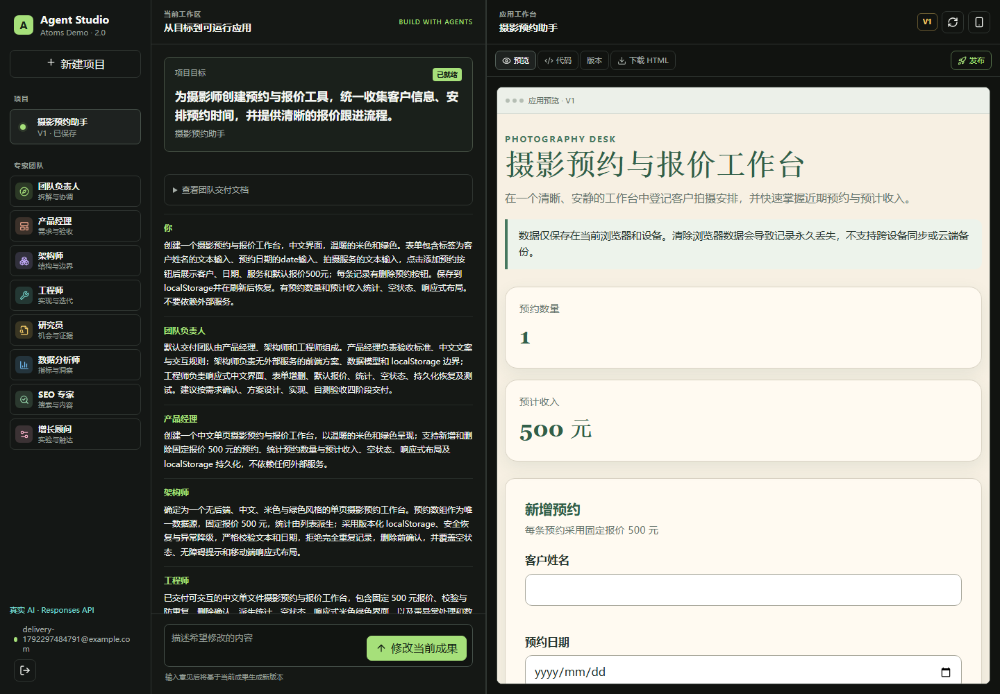
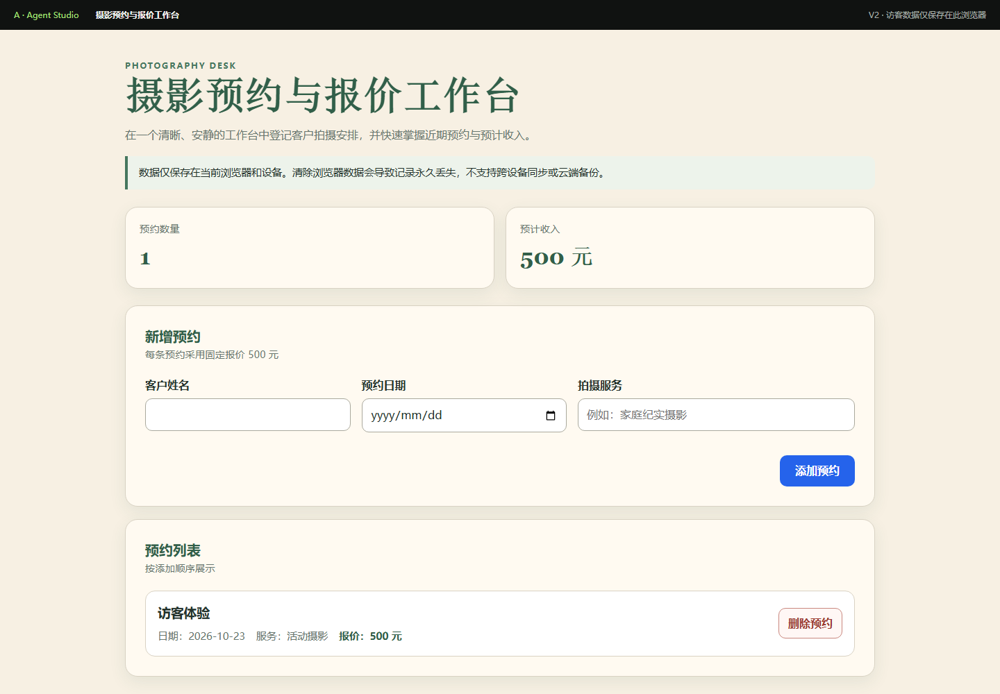

# 验收与部署记录｜2.0.0

日期：2026-10-18（Asia/Shanghai）。本文记录实际执行的验证，不把模型输出的“已完成”当作功能验收证据。

## 测试结果

| 检查 | 结果与范围 |
| --- | --- |
| ESLint | `pnpm lint` 通过，补齐了原工程缺失的 ESLint 配置 |
| TypeScript | `pnpm exec tsc --noEmit` 通过 |
| 单元 / 集成 | `pnpm test`：33 个测试文件、157 项测试通过 |
| 生产构建 | Windows 本地构建通过；最终源码在 Linux standalone 构建通过 |
| 模板模式浏览器验收 | 2 条完整 Chromium E2E 通过，覆盖注册、构建、咨询、迭代、下载、发布撤销、访客隔离、版本恢复、多项目、刷新、移动端与沙箱 |
| 真实模型最小调用 | 从指定服务器请求 Responses 服务，收到有效文本输出 |
| 真实团队链路 | `verify-builder-flow.cjs` 完成 Leader / PM / Architect / Engineer / Reviewer，保存 ready 状态和 V1 |
| 真实浏览器验收 | 1 条完整真实模型 Chromium E2E 通过，约 2.7 分钟，覆盖下方 12 个关键检查 |
| 代码差异检查 | `git diff --check` 通过 |

测试期间发现并修复：原有 E2E 仍操作已删除的模型配置/审批页；集成测试缺少显式 Mock 环境；输入框模式切换的延迟 effect 会覆盖新输入；预览按钮无行为；原生确认弹窗在沙箱内不可用。最终预览允许 scripts/forms/modals，仍不允许 same-origin、顶层导航或网络请求。新增测试同时验证确认弹窗、网络封锁与父页面 DOM 隔离。

真实模型生成的删除按钮还带有具体客户的无障碍标签，验收脚本按语义匹配按钮，处理确认弹窗，不依赖固定模板 DOM。

后续真实回归中，模型把一条验收标记写在 JavaScript 动态创建的元素上，静态审核因缺失标记终止。已强化工程师提示，并加入一次带审核反馈的自动修复；测试验证修复收到当前应用和缺失条件，修复仍失败时严格停止。此记录保留异常与修复过程，不把前一次失败算作通过。

## 最终真实模型验收与截图

完成时间：**2026-10-18 12:27:26（北京时间）**。环境为线上 `MOCK_LLM=false`，运行模型 `gpt-5.6-sol`。完整结果保存在 [真实模型验收结果.json](./真实模型验收结果.json)，不含账户密码或模型密钥。

可直接体验：[摄影预约与报价工作台 · 公开 V2](http://atoms.ai-diy.me/share/YjUvPwTRCHXswwONjrE5SuFr)。这是验收期间由模型实际生成、迭代并发布的应用。访客可添加自己的测试记录，数据保存在当前浏览器。

1. 新账户注册后进入真实 AI 工作区。
2. Leader、PM、Architect、Engineer 完成生成，保存 V1 并通过静态审核。
3. 在生成应用中填写客户、日期、服务并添加预约，列表与统计更新。
4. 通过项目状态 API 确认业务记录已经写入 SQLite。
5. 刷新工作区，原记录仍显示。
6. 真实模型将添加按钮修改为蓝色，生成 V2；浏览器检查实际颜色，原记录保留。
7. 将 V2 发布为公开链接。
8. 无登录访客打开公开页，看不到作者的业务记录。
9. 访客添加自己的记录并刷新，记录仍存在。
10. 删除访客记录，处理原生确认弹窗并验证记录消失。
11. 作者恢复 V1，已有数据仍保留，线上发布版本仍为 V2。
12. 工作区切换到 390 × 844 窄屏，页面无横向溢出，应用记录可见。

桌面工作区（V1 生成后，已保存一条预约）：



公开应用（V2，按钮已经变蓝；截图中的访客记录为独立测试数据）：



[查看完整移动端截图](./截图/03-mobile.png)。截图来自实际 Chromium 浏览器运行，没有使用静态设计稿替代功能验收。

## 复现命令

```sh
pnpm install --frozen-lockfile
pnpm db:generate
pnpm lint
pnpm exec tsc --noEmit
pnpm test
pnpm build
pnpm exec playwright install chromium
pnpm test:e2e
```

真实线上验收会消耗已配置模型额度，需要显式启用：

```powershell
$env:RUN_LIVE_TEST = '1'
$env:DEMO_URL = 'http://atoms.ai-diy.me'
pnpm exec playwright test -c playwright.live.config.ts
```

真实测试创建临时账户并生成 V1、V2，验证表单与数据库、发布页面的访客隔离、数据保留、删除、恢复和窄屏。临时登录信息与原始日志位于被 Git 忽略的 `.artifacts/`，不会随源码公开。正式交付只保存无密钥的结果与截图。

## 部署拓扑

```text
http://atoms.ai-diy.me:80
        │
        ▼
agent-studio-proxy（独立 Nginx，80）
        │ X-Real-IP 覆盖、SSE 不缓冲
        ▼
agent-studio（127.0.0.1:3000，独立用户）
        ├─ /var/lib/agent-studio/agent-studio.db
        └─ 服务器 Responses API 配置

既有 Dufs Docker 容器 ── 原 443 端口 ── 原数据与 TLS 配置
```

- SSH：`ssh aliyun-chenli`
- 域名 A 记录：`atoms.ai-diy.me → 39.105.85.114`
- 生产环境：Alibaba Cloud Linux 3，Node.js 22.23.3，Next.js 15.5.23，Prisma 6.19.3。
- 持久数据：`/var/lib/agent-studio/agent-studio.db`，与源码版本目录分离。
- 配置：`/etc/agent-studio.env`，权限 `root:agentstudio 0640`，线上 `MOCK_LLM=false`。
- 独立服务：`agent-studio.service`、`agent-studio-proxy.service`，均设置开机启动。
- 当前源码与构建目录：`/opt/agent-studio/releases/2.0.0-verified`；`current` 指向此目录，75 个部署源文件经 SHA-256 与本地交付源文件逐一核对一致。
- 资源限制：构建 MemoryMax 1100 MB、CPUQuota 80%；应用 MemoryMax 650 MB、CPUQuota 120%；代理 MemoryMax 100 MB、CPUQuota 30%。CPUQuota 100% 表示一个逻辑 CPU。
- 没有启用系统自带的默认 `nginx.service`，没有修改 Docker 或 Dufs 的端口配置。

最终重建时 Prisma 官方引擎下载短暂失败，复用了同机上一候选版本的 Prisma 6.19.3 / rhel-openssl-1.1.x 引擎；逐个比较 SHA-256 确认一致后重新生成客户端和构建。依赖版本未改变。

健康检查：

```json
{"status":"ok","version":"2.0.0","mode":"live"}
```

公网域名与 loopback 健康端点均已检查。健康端点验证数据库和必要配置，模型服务的实际可用性由独立的真实调用和生成验收确认。

## Dufs 不受影响的核验

Dufs 的实际路径是 `/dufs/`，根路径 `/` 原本返回 `400 Invalid Path`，不能用根路径判断故障。未携带凭据访问 `/dufs/` 返回 `401` 和 `WWW-Authenticate: Basic realm="DUFS"`，这是其原有访问控制响应。

部署前记录的容器：

- 名称：`buddy-update-services-dufs-1`
- 容器 ID 前缀：`cc5c36ca188c`
- 启动时间：`2026-10-14T11:35:43.776739443Z`
- 重启次数：`0`
- 端口：`0.0.0.0:443 → 5000/tcp`，同时保留原 IPv6 映射

部署后复核相同容器 ID、启动时间、重启次数和端口，且 `/dufs/` 的认证响应保持一致。没有使用 Dufs 账户执行上传/删除等写操作。

## 运维与回退

```sh
systemctl status agent-studio agent-studio-proxy --no-pager
journalctl -u agent-studio -n 50 --no-pager
curl -fsS http://127.0.0.1:3000/api/health
curl -fsS http://atoms.ai-diy.me/api/health
nginx -t -c /opt/agent-studio/current/deploy/nginx.conf
```

激活脚本在迁移前用 SQLite `.backup` 创建一致性备份。若需要手工恢复数据库，先停止 **agent-studio**，用指定备份替换其数据库，恢复 `agentstudio` 所有权，再启动该服务；不要停止 Docker 或 Dufs。涉及未来破坏性迁移时应制定单独的数据回退方案。

当前示例使用 HTTP 80。不会把指向 Dufs 的 443 连接当成本 Demo 的 HTTPS 入口；浏览器访问时应使用文档给出的完整 HTTP 链接。
